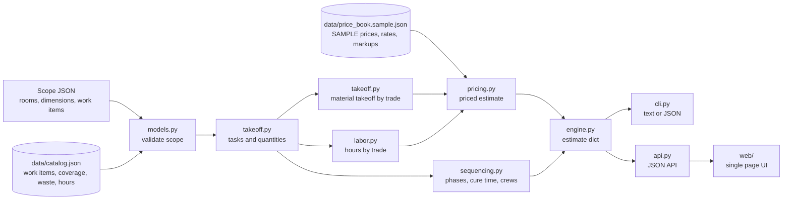

# remodel-estimator

Estimating a remodel by hand means measuring the room, then redoing the same takeoff, waste, labor and markup arithmetic on every job, and small slips compound into a wrong price.
This engine takes a scope (rooms, dimensions, selected work items) and returns the takeoff, labor, sequence and a priced estimate the same way every time.

> **Every price in this repository is fake and labelled sample.** The bundled price book (`data/price_book.sample.json`) is invented for demonstration. Replace the price book with your own before quoting any real work.

## What it does

Given a scope JSON file, the engine produces:

- **Material takeoff by trade.** Each work item lists the materials it needs, how much one purchase unit covers, and a waste factor. Quantities are summed per SKU across all rooms and rounded up once to whole purchase units.
- **Labor hours by trade.** Setup hours plus hours per unit, scaled by a per room difficulty factor, with each trade's minimum billable hours applied.
- **Sequencing.** Work is ordered by phase inside each room (demolition, rough-in, drywall, tile, paint, flooring, finish), with cure and dry time, and one crew per trade so a trade is never in two places at once.
- **A priced estimate.** Materials, sales tax on materials, labor, overhead, contingency and profit, plus direct cost by trade. Money is computed with `Decimal` and rounded half up.
- **Notes.** Missing prerequisites (for example wall tile with no backer board in scope), trade minimums that were applied, and a reminder whenever the sample price book is in use.

It ships as a Python engine with tests, a CLI, and a single page web UI (static HTML and JS calling a small JSON API), with bathroom, kitchen and basement examples. The engine, CLI and API use the Python standard library only.

## Architecture



## Run it

Needs Python 3.10 or newer. Nothing to install for the app itself.

```
python -m remodel_estimator estimate bathroom
python -m remodel_estimator serve
```

The first command prints a full estimate for the bathroom example. The second starts the API and web UI at http://127.0.0.1:8000 (use `--port` if 8000 is taken).

Other commands:

```
python -m remodel_estimator estimate examples/kitchen.json --json
python -m remodel_estimator estimate basement --price-book path/to/your_price_book.json
python -m remodel_estimator examples
python -m remodel_estimator catalog
```

## Run the tests

```
python -m pip install -r requirements-dev.txt
python -m pytest
```

There are 61 tests covering room geometry, scope validation, takeoff and waste math, labor minimums, sequencing rules, pricing arithmetic checked against a hand calculation, the CLI, and the API over a real local socket. CI (`.github/workflows/ci.yml`) runs the tests and the demo on Python 3.10 and 3.12.

## Demo

```
python demo/run_demo.py
```

Runs fully offline. It estimates the bathroom, kitchen and basement examples, then starts the API on a free local port and posts a scope to it. The captured output is in [`demo/output.txt`](demo/output.txt). The end of it looks like this:

```
SUMMARY (sample prices)
  Sample hall bathroom remodel      18 working days   $   15,580.72
  Sample kitchen remodel            15 working days   $   23,669.78
  Sample basement finish            23 working days   $   32,538.83

API ROUND TRIP (local server on a free port, same engine as the CLI)
  POST /api/estimate -> HTTP 200
  project        Sample hall bathroom remodel
  price book     Sample price book (sample: True)
  takeoff lines  34
  working days   18
  total          $15,580.72 (sample prices)
```

## Scope format

```json
{
  "project": "Sample hall bathroom remodel",
  "rooms": [
    {
      "name": "Hall bath",
      "length_ft": 8, "width_ft": 5, "height_ft": 8,
      "doors": 1, "windows": 1,
      "labor_factor": 1.0,
      "work_items": [
        {"code": "tile_floor"},
        {"code": "cement_board", "qty": 75},
        {"code": "tile_shower_walls", "qty": 75, "waste": 0.15}
      ]
    }
  ]
}
```

- Items measured from the room (`floor_sf`, `wall_sf`, `ceiling_sf`, `perimeter_lf`) need no quantity. Give `qty` to override.
- Items measured in `lf` or `sf` that the room cannot tell you (cabinet runs, shower wall area) need a `qty`. Items counted `each` default to 1.
- `waste` overrides the catalog waste factor for one item, for example a diagonal tile layout.
- `labor_factor` scales labor in one room, for example 1.1 for a basement with tight access.
- Wall area is the gross perimeter times height, less 20 sf per door and 12 sf per window.

Run `python -m remodel_estimator catalog` for the list of work item codes.

## Replace the price book

1. Copy `data/price_book.sample.json` to a new file and set `"sample": false`.
2. Put in your own material unit prices, labor rates, trade minimum hours, crew sizes and markups.
3. Point the app at it with `--price-book your_file.json` or the `REMODEL_PRICE_BOOK` environment variable (see `.env.example`).

If your price book is missing a SKU or a trade that the scope needs, the estimate fails with a list of what is missing. It never silently prices something at zero. Coverage, waste factors and labor hours per unit live in `data/catalog.json`; tune those to your own crews too.

## API

| Method | Path | Returns |
| --- | --- | --- |
| GET | `/api/health` | status and the price book header, including the sample flag |
| GET | `/api/catalog` | selectable work items and phases |
| GET | `/api/examples` | list of example scopes |
| GET | `/api/examples/<name>` | one example scope |
| POST | `/api/estimate` | scope JSON in, estimate JSON out. A bad scope returns 400 with every problem listed |

## Where this pattern runs

This is drawn from systems that run two small service companies day to day, where estimates are built from a measured scope, a catalog of work items and a price book rather than retyped per job. The code here is a clean, standalone version of that pattern with invented data.

## Limitations

- **The numbers are not real.** Prices, labor rates, production rates, coverage and waste factors are all sample values chosen to look plausible. Do not quote from them.
- **Rooms are rectangles.** No L shapes, sloped ceilings, soffits or stairs. Use `qty` overrides for anything irregular.
- **Flat production rates.** Labor is setup plus hours per unit with one multiplier per room. There is no learning curve, no small job premium beyond the trade minimum, and no travel time.
- **Simple sequencing.** Phases within a room, cure time, and one crew per trade. It does not model inspections, lead times, deliveries, weekends, or one trade waiting on another trade's work in a different room. The day count is working days, not a calendar.
- **One price per SKU.** No quantity breaks, supplier choice, allowances versus selections, or regional adjustment. Tax applies to materials only and markups are single percentages.
- **Catalog is small.** About 35 work items aimed at bathrooms, kitchens and basements. No structural work, HVAC, roofing, exterior work or permits.
- **The API is a development server.** It uses the standard library HTTP server with no authentication, no rate limiting and no TLS. Run it on localhost or put it behind something that handles those.
- **No persistence.** Estimates are computed and returned, not saved. There are no revisions, change orders or customer records.

License: MIT, see the LICENSE file.
