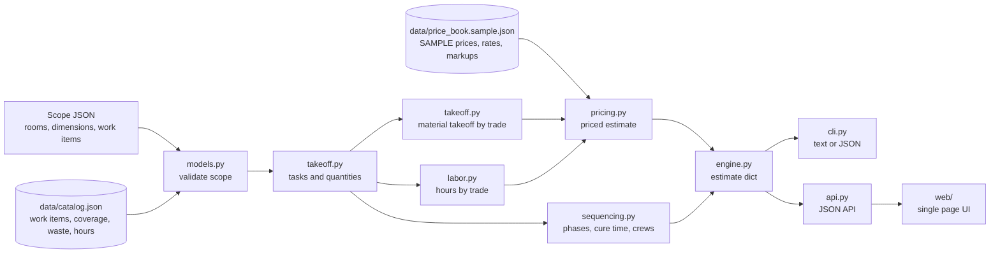

# remodel-estimator

**Live demo:** https://remodel-estimator-beige.vercel.app (read-only: the three bundled examples with sample prices, built by `python demo/build_static_site.py` from the same engine. Clone the repo to estimate your own scope.)

Turn a measured remodel scope into an estimate a crew can build from: what to buy by trade (with waste, rounded up to whole boxes, bags and sheets), labor hours by trade, the order of work, and a price.

It is for remodeling contractors and for people building estimating tools for them. Estimating by hand means redoing the same takeoff, waste, labor and markup arithmetic on every job, and small slips compound into a wrong price. Here you describe the job once (rooms, dimensions, work items) and the same rules run every time, from a catalog and a price book you control.

> **Every price in this repository is fake and labelled sample.** The bundled price book (`data/price_book.sample.json`) is invented for demonstration and is meant to be replaced. Put in your own prices, rates and markups before quoting any real work.

## What you will see

`python -m remodel_estimator estimate bathroom` estimates a gut remodel of a 5 x 8 ft hall bath. This is an excerpt of the real output (the full report is about 250 lines; `...` marks cuts):

```
ESTIMATE: Sample hall bathroom remodel
Price book: Sample price book (SAMPLE PRICES, NOT REAL)

ROOMS
  Hall bath        8 x 5 x 8 ft   floor 40 sf   walls 176 sf   perimeter 26 lf   baseboard 10 lf
...
MATERIAL TAKEOFF BY TRADE (waste included, rounded up to whole purchase units)
  [drywall]
    material                                                 net  waste   buy unit         each    extended
    Drywall screws 1-1/4 in, 5 lb box (sample)              0.15   0.0%     1 box        $29.00      $29.00
    Drywall sheet 4x8, half inch (sample)                   4.69  12.0%     6 sheet      $15.50      $93.00
    Drywall paper tape, 250 ft roll (sample)                0.22   0.0%     1 roll        $6.00       $6.00
    All purpose joint compound, 4.5 gal (sample)            0.33   0.0%     1 bucket     $21.00      $21.00
  [tile]
    material                                                 net  waste   buy unit         each    extended
    Alkali resistant mesh tape, 150 ft roll (sample)        0.46   0.0%     1 roll        $9.00       $9.00
    Backer board screws 1-1/4 in, box of 185 (sample)       1.63   0.0%     2 box        $13.50      $27.00
    Cement backer board 1/2 in, 3x5 (sample)                5.00  10.0%     6 sheet      $17.00     $102.00
    Cement backer board 1/4 in, 3x5 floor (sample)          2.67  10.0%     3 sheet      $14.00      $42.00
    Grout, 25 lb bag (sample)                               1.15   5.0%     2 bag        $24.00      $48.00
    Thinset mortar, 50 lb bag (sample)                      2.83   5.0%     3 bag        $29.00      $87.00
    Floor tile, per square foot (sample)                   40.00  10.0%    44 sf          $6.40     $281.60
    Wall tile, per square foot (sample)                    75.00  12.0%    84 sf          $5.25     $441.00
    Liquid waterproofing membrane, gallon (sample)          1.50   5.0%     2 gal        $64.00     $128.00
...
LABOR BY TRADE
  trade           hours  billable      rate         cost
  plumbing        21.50     21.50   $110.00    $2,365.00
  electrical       8.70      8.70   $105.00      $913.50
  drywall          9.60      9.60    $65.00      $624.00
  tile            35.60     35.60    $80.00    $2,848.00
...
SEQUENCE (19 working days, one crew per trade; start and end are working days elapsed since the job started)
   start    end  room         work item                              trade       note
       4   4.16  Hall bath    Hang ceiling drywall                   drywall
       4      5  Hall bath    Cement backer board                    tile
    4.16    4.5  Hall bath    Hang wall drywall                      drywall
       5   5.16  Hall bath    Ceiling drywall: tape coat             drywall     then wait 1 day to dry
       5    5.5  Hall bath    Roll on waterproofing membrane         tile        then wait 1 day to cure
    5.16    5.5  Hall bath    Wall drywall: tape coat                drywall     then wait 1 day to dry
     6.5   6.63  Hall bath    Ceiling drywall: second coat           drywall     then wait 1 day to dry
     6.5    8.5  Hall bath    Tile shower walls: set tile            tile        then wait 1 day to cure
    6.63      7  Hall bath    Wall drywall: second coat              drywall     then wait 1 day to dry
       8   8.13  Hall bath    Ceiling drywall: finish coat           drywall     then wait 1 day to dry
    8.13    8.5  Hall bath    Wall drywall: finish coat              drywall     then wait 1 day to dry
     9.5   9.64  Hall bath    Ceiling drywall: sand                  drywall
     9.5     10  Hall bath    Tile shower walls: grout               tile        then wait 1 day to cure
    9.64     10  Hall bath    Wall drywall: sand                     drywall
      11  11.26  Hall bath    Paint ceiling                          paint
   11.26     12  Hall bath    Prime and paint walls                  paint
      12   12.5  Hall bath    Floor tile underlayment, backer board  tile
    12.5   13.5  Hall bath    Tile floor: set tile                   tile        then wait 1 day to cure
    14.5     15  Hall bath    Tile floor: grout                      tile        then wait 1 day to cure
...
      17  17.37  Hall bath    Outlet or switch: device and plate     electrical
   17.37   17.5  Hall bath    Bath fan: grille and test              electrical
...
TOTALS
  Materials                       $4,422.60
  Sales tax on materials            $353.81
  Labor                           $8,527.05
  Direct cost                    $13,303.46
  Overhead                        $1,330.35
  Contingency                       $665.17
  Profit                          $1,529.90
  -----------------------------------------
  ESTIMATE TOTAL                 $16,828.88

NOTES
  * insulation: 0.98 estimated hours raised to the 2 hour trade minimum.
  * general: 1.4 estimated hours raised to the 2 hour trade minimum.
  * Prices come from a sample price book and are not real. Replace it before quoting.

ASSUMPTIONS (catalog defaults used in this estimate; check them against how you build)
...
  * Drywall dry time: one dry day after each coat of premixed all purpose compound. That holds
    at about 60 to 70 F and 50 percent humidity with ventilation. The gypsum industry drying
    table gives about 17 hours at 70 F and 50 percent humidity, 24 hours at 60 F, 26 hours at 70
    F and 70 percent, and 38 hours at 60 F and 70 percent, so allow two days a coat in a cool
    damp basement and keep the room at 50 F or warmer. Setting compound would shorten the wait.
  * Tile is two visits: set, then grout after the mortar has cured for a day. Grout makers ask
    for 24 to 48 hours of mortar cure before grouting unless the mortar is rapid setting, and
    for 16 to 24 hours on the grout before it is walked on or disturbed, so a second day follows
    the grout. How the hours divide between setting and grouting is a judgment. Tile waste is 10
    percent for a straight layout on a floor or backsplash and 12 percent on shower walls; use
    the waste override for a diagonal or herringbone layout (15 percent or more).
  * Floor tile underlayment default: 1/4 inch cement backer board bedded in thinset over a sound
    wood subfloor, screwed 8 inches on center, seams mesh taped and filled with thinset. The
    thinset bed, the 1/4 inch square notch trowel and the 8 inch screw spacing are the board
    makers' instructions. The board goes down after paint, right before the floor tile: that
    order is a judgment, since the makers' instructions do not set one. If you use an uncoupling
    membrane instead, swap this item for your own.
  * Hall bath: baseboard is 10 lf: the 26 lf perimeter less 3 lf for 1 door opening at 3 lf
    each, 10 lf for shower alcove, 3 lf for vanity.
```

The dollar figures mean nothing: they come from the sample price book. What carries over to a real job is the method, for example 75 sf of shower wall becoming 84 sf of tile, 6 sheets of backer board and 2 gallons of membrane, the floor getting its own backer board before tile, grout waiting a day for the mortar, and the shower being tiled while the drywall coats dry. The full output for all three examples is in [`demo/output.txt`](demo/output.txt).

## What it does

Given a scope JSON file, the engine produces:

- **Material takeoff by trade.** Each work item lists the materials it needs, how much one purchase unit covers, and a waste factor. Quantities are summed per SKU across all rooms and rounded up once to whole purchase units.
- **Labor hours by trade.** Setup hours plus hours per unit for every visit, scaled by a per room difficulty factor, with each trade's minimum billable hours applied.
- **Sequencing.** Work is ordered by phase inside each room (demolition, rough-in, shower base, board hanging, drywall coats, waterproofing, wall tile and its grout, paint, floor underlayment, floor tile and its grout, cabinets, finish plumbing, finish electrical, trim, trim paint), with cure and dry time, and one crew per trade so a trade is never in two places at once. One scope line can be several visits: drywall is hang, tape coat, second coat, finish coat and sand; tile is set, then grouted after the mortar cures; an outlet is a rough-in visit and a trim-out visit.
- **A priced estimate.** Materials, sales tax on materials, labor, overhead, contingency and profit, plus direct cost by trade. Money is computed with `Decimal` and rounded half up.
- **Notes.** Missing prerequisites (for example wall tile with no backer board, or floor tile with no underlayment or slab prep in scope), trade minimums that were applied, and a reminder whenever the sample price book is in use.
- **Assumptions.** The catalog defaults that shaped this estimate (underlayment type, drywall coat schedule and dry time, membrane coverage, fastener box sizes, how the baseboard length was worked out), printed so they can be checked. Each one is listed as confirmed, corrected or judgment in [`docs/assumptions.md`](docs/assumptions.md).

It ships as a Python engine with tests, a command line tool, and a single page web UI (static HTML and JS calling a small JSON API), with bathroom, kitchen and basement examples. The engine, CLI and API use the Python standard library only.

## Run it

Needs Python 3.10 or newer. Nothing to install for the app itself.

```
python -m remodel_estimator estimate bathroom
python -m remodel_estimator serve
```

The first command prints the full estimate for the bathroom example. The second starts the API and web UI at http://127.0.0.1:8000 (use `--port` if 8000 is taken). The web UI needs that server running: the page calls the API for the catalog and for every estimate.

Other commands:

```
python -m remodel_estimator estimate examples/kitchen.json --json
python -m remodel_estimator estimate basement --price-book path/to/your_price_book.json
python -m remodel_estimator examples
python -m remodel_estimator catalog
```

## Run the tests

pytest is the only dependency, and only for the tests. A virtual environment in the project folder keeps it out of your system Python:

```
python -m venv .venv
.venv\Scripts\activate
python -m pip install -r requirements-dev.txt
python -m pytest
```

On macOS or Linux the second line is `source .venv/bin/activate`.

There are 130 tests covering room geometry, scope validation, takeoff and waste math, labor minimums, sequencing rules, the trade logic (floor substrate, rough and finish visits, drywall coats, tile set and grout visits, baseboard deductions, fastener coverage, the source checked material quantities, pinned production rates), pricing arithmetic checked against a hand calculation, the CLI, the API over a real local socket, and the static demo site (its JSON must equal what the engine and the API return). CI (`.github/workflows/ci.yml`) runs the tests, the demo and the static site build on Python 3.10 and 3.12.

## Demo

```
python demo/run_demo.py
```

Runs fully offline. It estimates the bathroom, kitchen and basement examples, then starts the API on a free local port and posts a scope to it. It rewrites [`demo/output.txt`](demo/output.txt), which ends like this:

```
SUMMARY (sample prices)
  Sample hall bathroom remodel      19 working days   $   16,828.88
  Sample kitchen remodel            20 working days   $   23,825.87
  Sample basement finish            27 working days   $   34,735.92

API ROUND TRIP (local server on a free port, same engine as the CLI)
  POST /api/estimate -> HTTP 200
  project        Sample hall bathroom remodel
  price book     Sample price book (sample: True)
  takeoff lines  37
  working days   19
  total          $16,828.88 (sample prices)
```

## Scope format

```json
{
  "project": "Sample hall bathroom remodel",
  "rooms": [
    {
      "name": "Hall bath",
      "length_ft": 8, "width_ft": 5, "height_ft": 8,
      "doors": 1, "windows": 1,
      "labor_factor": 1.0,
      "base_deductions": [
        {"label": "shower alcove", "lf": 10},
        {"label": "vanity", "lf": 3}
      ],
      "work_items": [
        {"code": "floor_backer_board"},
        {"code": "tile_floor"},
        {"code": "cement_board", "qty": 75},
        {"code": "tile_shower_walls", "qty": 75, "waste": 0.15},
        {"code": "baseboard"}
      ]
    }
  ]
}
```

- Items measured from the room (`floor_sf`, `wall_sf`, `ceiling_sf`, `perimeter_lf`, `baseboard_lf`) need no quantity. Give `qty` to override.
- Items measured in `lf` or `sf` that the room cannot tell you (cabinet runs, shower wall area) need a `qty`. Items counted `each` default to 1.
- `waste` overrides the catalog waste factor for one item, for example a diagonal tile layout.
- `labor_factor` scales labor in one room, for example 1.1 for a basement with tight access.
- Wall area is the gross perimeter times height, less 20 sf per door and 12 sf per window.
- Baseboard length is the perimeter less 3 lf per door, less every run listed in `base_deductions` (tub or shower, vanity, cabinets, appliances). `base_deductions` is optional: a scope without it still works and deducts the doors only. The estimate prints the arithmetic for each room.
- A staged item is still one line in the scope. `{"code": "drywall_walls"}` produces the five drywall visits, `{"code": "tile_floor"}` produces the setting visit and the grout visit, and `{"code": "device", "qty": 3}` produces the rough-in and the trim-out.

Run `python -m remodel_estimator catalog` for the list of work item codes.

## Replace the price book

1. Copy `data/price_book.sample.json` to a new file and set `"sample": false`.
2. Put in your own material unit prices, labor rates, trade minimum hours, crew sizes and markups.
3. Point the app at it with `--price-book your_file.json` or the `REMODEL_PRICE_BOOK` environment variable (see `.env.example`).

If your price book is missing a SKU or a trade that the scope needs, the estimate fails with a list of what is missing. It never silently prices something at zero. Coverage, waste factors and labor hours per unit live in `data/catalog.json`; tune those to your own crews and products too.

**The production rates are sample values and are judgment.** The hours per unit in the catalog are not measured from any crew, and they are not confirmed by any published labor guide: those guides are paid publications that could not be opened when the defaults were source checked. A contractor should replace them with numbers from their own jobs before trusting the labor hours or the schedule.

## Assumptions a contractor should check

These are the defaults built into the catalog and the examples. Each one was looked up against manufacturer installation instructions and data sheets, gypsum industry documents, building code commentary and whatever published references could be opened, then labelled:

- **confirmed**: a source that was read says the same, or gives a range the value sits inside.
- **corrected**: a source disagreed and the catalog was changed.
- **judgment**: no authoritative source was found or could be opened. The value stays, and another contractor could reasonably choose differently.

All prices and rates here are samples a contractor should replace with their own. Confirmed means defensible as a default, not right for your crew, product or site. The fuller notes, the ranges, the site conditions that change the answer and the list of sources (including the ones that could not be opened) are in [`docs/assumptions.md`](docs/assumptions.md). The assumptions that apply are also printed under ASSUMPTIONS on every estimate.

| Assumption | Value used | Status | Source type |
| --- | --- | --- | --- |
| Floor tile underlayment | 1/4 inch cement backer board over a wood subfloor | confirmed | two backer board makers' installation guides |
| Thinset bed under floor backer board | latex modified thinset, 1/4 inch square notch, one 50 lb bag per 75 sf with seam fill | confirmed | backer board makers' guides; mortar coverage charts (77 to 100 sf per bag) |
| Backer board fastener spacing | 8 inches on center on floors and walls, 1-1/4 inch screws | confirmed | backer board makers' guides |
| Backer board screws per square foot | about 2 on walls, 3.7 on floors (90 and 50 sf per box) | judgment | worked out from the spacing; no published count. Floors compute to 2.7 to 3.6, so this is the high end |
| Backer board screw box size | box of 185 | confirmed | retail listings (weak) |
| Floor backer board after paint and wall board | wall board early, floor board right before floor tile | judgment | makers' guides do not set an order |
| Shower wall board | 1/2 inch cement board, studs at 16 inches, mesh taped seams | confirmed | cement board maker's guide |
| Shower pan before backer board | pan set on bare studs, board stops above its flange | confirmed | shower base maker's manual |
| Liquid membrane coverage | two coats, 50 sf per gallon finished | confirmed | three membrane data sheets (40 to 55 sf per gallon, less on rough board; this is the middle) |
| Membrane cure before tile | one day | confirmed | membrane data sheets (2 to 24 hours before a flood test, longer when cold; this is the long end) |
| Shower tiled while the drywall coats dry | tile track waits for hung board only | judgment | none found for or against |
| Drywall coat schedule | hang, tape coat, second coat, finish coat, sand | confirmed | board maker's summary of the gypsum industry levels of finish (Level 4); compound data sheet |
| Drywall dry time per coat | one day, premixed all purpose compound | confirmed | Gypsum Association GA-236 drying table: 17 hours at 70 F and 50 percent humidity, 38 hours at 60 F and 70 percent. Two days a coat in a cool damp room |
| Joint compound quantity | 10 gallons per 1,000 sf (one 4.5 gallon bucket per 450 sf) | confirmed | board maker's estimator, compound data sheet, trade magazine (9 to 11 gallons; this is the middle) |
| Joint tape quantity | 370 ft per 1,000 sf, was 417 | corrected | board maker's estimator (350 ft) and trade magazine (370 ft) |
| Drywall screws | 1,250 per 1,000 sf, one 5 lb box; was a box per 900 sf of wall or 750 sf of ceiling | corrected | board maker's estimator; retail box counts (weak) |
| Drywall screw spacing | 12 inches on ceilings, 16 on walls | confirmed | The Gypsum Construction Handbook, cladding chapter |
| Ceilings before walls | ceilings hung first | confirmed | The Gypsum Construction Handbook, cladding chapter |
| Tile set and grout as separate visits | set, one cure day, grout, one more day; was one visit and one cure day | corrected | two grout data sheets (24 to 48 hours of mortar cure before grouting; 16 to 24 hours before the grout is walked on) |
| Thinset and grout quantities | 50 sf per 50 lb bag of thinset, 100 sf per 25 lb bag of grout | judgment | inside mortar and grout coverage charts, which vary widely with tile size, notch and joint |
| Tile waste by layout | 10 percent floors and backsplash, 12 percent shower walls, override for diagonal (15 percent or more) | judgment | tile seller's and plank maker's ordering advice only; no standards body figure found |
| Tile on a slab | scrape and patch, no board, no moisture test | judgment | none |
| Floating plank after base cabinets | plank runs to the toe kick, never under cabinets | confirmed | plank maker's installation instructions |
| Floating plank waste | 10 percent, was 8 | corrected | plank maker's installation instructions |
| Primer and paint coverage and coats | one primer coat at 300 sf per gallon, two finish coats at 350 | confirmed | paint data sheet and primer product page (300 to 400 sf per gallon; low end for primer, middle for paint) |
| Pressure treated bottom plate on a slab | treated plate under every wall on the slab | confirmed | residential code decay rule as quoted in a trade journal code Q&A and a code training site; official text not opened |
| Sill sealer under the plate | foam sill sealer under the treated plate | judgment | trade journal describes what it does; nothing requires it here |
| Slab fastener spacing | about every 32 inches, 6 inches from plate ends | confirmed | two code evaluation reports for powder driven pins (3 ft and 4 ft maximum on interior non bearing walls) |
| Double top plate | two top plates on slab walls | judgment | none |
| Electrical rough-in and trim-out split | 0.6 hours rough, 0.3 finish per device, half hour trim-out setup | judgment | labor unit manuals could not be opened |
| Rough plumbing hours per fixture | 4 hours per fixture plus 1 hour setup | judgment | labor guides could not be opened |
| Shower valve in two visits | valve body at rough-in (2 hours), trim after grout (0.75 hours) | judgment | none |
| Baseboard deductions | perimeter less 3 lf per door, less listed runs | judgment | estimating convention; the arithmetic is printed |
| Trim painted after it is installed | own paint visit: fill, caulk, two coats | judgment | none |
| Visits rounded to half days | one trade, one room, one phase is one visit | judgment | scheduling simplification |
| Production rates | every hours per unit in the catalog (tile 0.16 and 0.22 per sf, drywall 0.045 and 0.06, paint 0.025, and the rest) | judgment | labor guides could not be opened |
| Bathroom gut total labor hours | about 104 hours for the 5 x 8 ft example | judgment | no authoritative figure found; it is the sum of the rates above |

Four rows were corrected in this review: three material quantities and one sequence. None of them moved a sample total, because each corrected quantity still rounds up to the same whole boxes, rolls and cartons in the three examples. The tile correction made each example two working days longer.

Could not be opened, so nothing rests on them: the tile industry installation handbook, the Gypsum Association's GA-214 and GA-216, the official residential code text, and every published labor guide.

## Architecture



## API

| Method | Path | Returns |
| --- | --- | --- |
| GET | `/api/health` | status and the price book header, including the sample flag |
| GET | `/api/catalog` | selectable work items and phases |
| GET | `/api/examples` | list of example scopes |
| GET | `/api/examples/<name>` | one example scope |
| POST | `/api/estimate` | scope JSON in, estimate JSON out. A bad scope returns 400 with every problem listed |

## Where this pattern runs

This is drawn from systems that run two small service companies day to day, where estimates are built from a measured scope, a catalog of work items and a price book rather than retyped per job. The code here is a clean, standalone version of that pattern with invented data.

## Limitations

- **The numbers are not real.** Prices, labor rates, production rates, coverage and waste factors are all sample values chosen to look plausible. Do not quote from them.
- **Rooms are rectangles.** No L shapes, sloped ceilings, soffits or stairs. Use `qty` overrides for anything irregular. Baseboard deductions are only as good as the runs you list: nothing is deducted for a tub, vanity or cabinet run unless it is in `base_deductions`.
- **Flat production rates.** Labor is setup plus hours per unit with one multiplier per room. There is no learning curve, no small job premium beyond the trade minimum, and no travel time.
- **Simple sequencing.** Phases within a room, cure and dry time, and one crew per trade. It does not model inspections, lead times (a fabricated countertop is templated and installed in one visit), deliveries, weekends, or one trade waiting on another trade's work in a different room. Paint is one visit with no recoat time between coats. Dry and cure waits are whole days at normal room conditions (about 60 to 70 F and 50 percent humidity); a cold or damp room needs longer and the engine does not know your room. Start and end times inside a shared visit are proportional to hours, so read them as an order, not a clock. The day count is working days, not a calendar.
- **One price per SKU.** No quantity breaks, supplier choice, allowances versus selections, or regional adjustment. Tax applies to materials only and markups are single percentages.
- **Catalog is small.** 41 work items aimed at bathrooms, kitchens and basements. No structural work, HVAC, roofing, exterior work or permits. One floor tile underlayment (cement backer board) and one shower system (cement board with roll on membrane). No uncoupling membrane, sheet membrane, mud bed or self leveling. No below slab plumbing for a basement bath. No panel or service work behind a new circuit.
- **The API is a development server.** It uses the standard library HTTP server with no authentication, no rate limiting and no TLS. Run it on localhost or put it behind something that handles those.
- **No persistence.** Estimates are computed and returned, not saved. There are no revisions, change orders or customer records.

License: MIT, see the LICENSE file.
