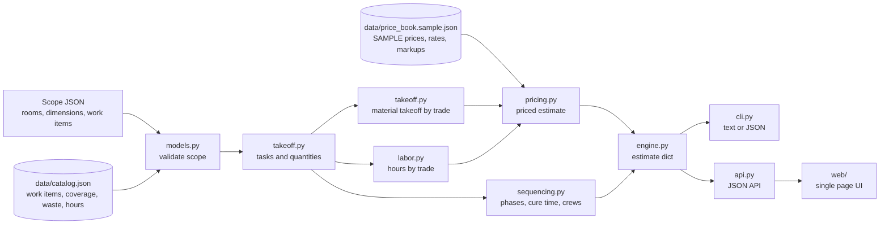

# remodel-estimator

Turn a measured remodel scope into an estimate a crew can build from: what to buy by trade (with waste, rounded up to whole boxes, bags and sheets), labor hours by trade, the order of work, and a price.

It is for remodeling contractors and for people building estimating tools for them. Estimating by hand means redoing the same takeoff, waste, labor and markup arithmetic on every job, and small slips compound into a wrong price. Here you describe the job once (rooms, dimensions, work items) and the same rules run every time, from a catalog and a price book you control.

> **Every price in this repository is fake and labelled sample.** The bundled price book (`data/price_book.sample.json`) is invented for demonstration and is meant to be replaced. Put in your own prices, rates and markups before quoting any real work.

## What you will see

`python -m remodel_estimator estimate bathroom` estimates a gut remodel of a 5 x 8 ft hall bath. This is an excerpt of the real output (the full report is about 150 lines; `...` marks cuts):

```
ESTIMATE: Sample hall bathroom remodel
Price book: Sample price book (SAMPLE PRICES, NOT REAL)

ROOMS
  Hall bath        8 x 5 x 8 ft   floor 40 sf   walls 176 sf   perimeter 26 lf
...
MATERIAL TAKEOFF BY TRADE (waste included, rounded up to whole purchase units)
  [drywall]
    material                                                 net  waste   buy unit         each    extended
    Drywall screws, box (sample)                            0.12   0.0%     1 box        $12.00      $12.00
    Drywall sheet 4x8, half inch (sample)                   4.69  12.0%     6 sheet      $15.50      $93.00
    Drywall tape roll (sample)                              0.18   0.0%     1 roll        $6.00       $6.00
    Joint compound bucket (sample)                          0.33   0.0%     1 bucket     $21.00      $21.00
  [tile]
    material                                                 net  waste   buy unit         each    extended
    Backer board screws, box (sample)                       0.50   0.0%     1 box        $13.50      $13.50
    Cement backer board 3x5 (sample)                        5.00  10.0%     6 sheet      $17.00     $102.00
    Grout, 25 lb bag (sample)                               1.15   5.0%     2 bag        $24.00      $48.00
    Thinset mortar, 50 lb bag (sample)                      2.30   5.0%     3 bag        $29.00      $87.00
    Floor tile, per square foot (sample)                   40.00  10.0%    44 sf          $6.40     $281.60
    Wall tile, per square foot (sample)                    75.00  12.0%    84 sf          $5.25     $441.00
    Liquid waterproofing membrane, gallon (sample)          1.50   5.0%     2 gal        $64.00     $128.00
...
LABOR BY TRADE
  trade           hours  billable      rate         cost
  plumbing        18.25     18.25   $110.00    $2,007.50
  insulation       0.98      2.00    $55.00      $110.00  (trade minimum applied)
  tile            31.90     31.90    $80.00    $2,552.00
...
SEQUENCE (18 working days, one crew per trade; start and end are working days elapsed since the job started)
   start    end  room         work item                              trade       note
     4.5      5  Hall bath    Set shower pan                         plumbing
       5    5.5  Hall bath    Hang and finish wall drywall           drywall     then wait 1 day to cure
       5      6  Hall bath    Cement backer board                    tile
       7    7.5  Hall bath    Roll on waterproofing membrane         tile        then wait 1 day to cure
     8.5     11  Hall bath    Tile shower walls                      tile        then wait 1 day to cure
...
TOTALS
  Materials                       $4,329.10
  Sales tax on materials            $346.33
  Labor                           $7,503.10
  Direct cost                    $12,178.53
  Overhead                        $1,217.85
  Contingency                       $608.93
  Profit                          $1,400.53
  -----------------------------------------
  ESTIMATE TOTAL                 $15,405.84

NOTES
  * insulation: 0.98 estimated hours raised to the 2 hour trade minimum.
  * Prices come from a sample price book and are not real. Replace it before quoting.
```

The dollar figures mean nothing: they come from the sample price book. What carries over to a real job is the method, for example 75 sf of shower wall becoming 84 sf of tile, 6 sheets of backer board and 2 gallons of membrane. The full output for all three examples is in [`demo/output.txt`](demo/output.txt).

## What it does

Given a scope JSON file, the engine produces:

- **Material takeoff by trade.** Each work item lists the materials it needs, how much one purchase unit covers, and a waste factor. Quantities are summed per SKU across all rooms and rounded up once to whole purchase units.
- **Labor hours by trade.** Setup hours plus hours per unit, scaled by a per room difficulty factor, with each trade's minimum billable hours applied.
- **Sequencing.** Work is ordered by phase inside each room (demolition, rough-in, shower base, drywall and backer board, waterproofing, tile, paint, flooring, finish), with cure and dry time, and one crew per trade so a trade is never in two places at once.
- **A priced estimate.** Materials, sales tax on materials, labor, overhead, contingency and profit, plus direct cost by trade. Money is computed with `Decimal` and rounded half up.
- **Notes.** Missing prerequisites (for example wall tile with no backer board in scope), trade minimums that were applied, and a reminder whenever the sample price book is in use.

It ships as a Python engine with tests, a command line tool, and a single page web UI (static HTML and JS calling a small JSON API), with bathroom, kitchen and basement examples. The engine, CLI and API use the Python standard library only.

## Run it

Needs Python 3.10 or newer. Nothing to install for the app itself.

```
python -m remodel_estimator estimate bathroom
python -m remodel_estimator serve
```

The first command prints the full estimate for the bathroom example. The second starts the API and web UI at http://127.0.0.1:8000 (use `--port` if 8000 is taken). The web UI needs that server running: the page calls the API for the catalog and for every estimate.

Other commands:

```
python -m remodel_estimator estimate examples/kitchen.json --json
python -m remodel_estimator estimate basement --price-book path/to/your_price_book.json
python -m remodel_estimator examples
python -m remodel_estimator catalog
```

## Run the tests

pytest is the only dependency, and only for the tests. A virtual environment in the project folder keeps it out of your system Python:

```
python -m venv .venv
.venv\Scripts\activate
python -m pip install -r requirements-dev.txt
python -m pytest
```

On macOS or Linux the second line is `source .venv/bin/activate`.

There are 61 tests covering room geometry, scope validation, takeoff and waste math, labor minimums, sequencing rules, pricing arithmetic checked against a hand calculation, the CLI, and the API over a real local socket. CI (`.github/workflows/ci.yml`) runs the tests and the demo on Python 3.10 and 3.12.

## Demo

```
python demo/run_demo.py
```

Runs fully offline. It estimates the bathroom, kitchen and basement examples, then starts the API on a free local port and posts a scope to it. It rewrites [`demo/output.txt`](demo/output.txt), which ends like this:

```
SUMMARY (sample prices)
  Sample hall bathroom remodel      18 working days   $   15,405.84
  Sample kitchen remodel            15 working days   $   23,669.78
  Sample basement finish            23 working days   $   32,538.83

API ROUND TRIP (local server on a free port, same engine as the CLI)
  POST /api/estimate -> HTTP 200
  project        Sample hall bathroom remodel
  price book     Sample price book (sample: True)
  takeoff lines  34
  working days   18
  total          $15,405.84 (sample prices)
```

## Scope format

```json
{
  "project": "Sample hall bathroom remodel",
  "rooms": [
    {
      "name": "Hall bath",
      "length_ft": 8, "width_ft": 5, "height_ft": 8,
      "doors": 1, "windows": 1,
      "labor_factor": 1.0,
      "work_items": [
        {"code": "tile_floor"},
        {"code": "cement_board", "qty": 75},
        {"code": "tile_shower_walls", "qty": 75, "waste": 0.15}
      ]
    }
  ]
}
```

- Items measured from the room (`floor_sf`, `wall_sf`, `ceiling_sf`, `perimeter_lf`) need no quantity. Give `qty` to override.
- Items measured in `lf` or `sf` that the room cannot tell you (cabinet runs, shower wall area) need a `qty`. Items counted `each` default to 1.
- `waste` overrides the catalog waste factor for one item, for example a diagonal tile layout.
- `labor_factor` scales labor in one room, for example 1.1 for a basement with tight access.
- Wall area is the gross perimeter times height, less 20 sf per door and 12 sf per window.

Run `python -m remodel_estimator catalog` for the list of work item codes.

## Replace the price book

1. Copy `data/price_book.sample.json` to a new file and set `"sample": false`.
2. Put in your own material unit prices, labor rates, trade minimum hours, crew sizes and markups.
3. Point the app at it with `--price-book your_file.json` or the `REMODEL_PRICE_BOOK` environment variable (see `.env.example`).

If your price book is missing a SKU or a trade that the scope needs, the estimate fails with a list of what is missing. It never silently prices something at zero. Coverage, waste factors and labor hours per unit live in `data/catalog.json`; tune those to your own crews and products too.

## Architecture



## API

| Method | Path | Returns |
| --- | --- | --- |
| GET | `/api/health` | status and the price book header, including the sample flag |
| GET | `/api/catalog` | selectable work items and phases |
| GET | `/api/examples` | list of example scopes |
| GET | `/api/examples/<name>` | one example scope |
| POST | `/api/estimate` | scope JSON in, estimate JSON out. A bad scope returns 400 with every problem listed |

## Where this pattern runs

This is drawn from systems that run two small service companies day to day, where estimates are built from a measured scope, a catalog of work items and a price book rather than retyped per job. The code here is a clean, standalone version of that pattern with invented data.

## Limitations

- **The numbers are not real.** Prices, labor rates, production rates, coverage and waste factors are all sample values chosen to look plausible. Do not quote from them.
- **Rooms are rectangles.** No L shapes, sloped ceilings, soffits or stairs. Use `qty` overrides for anything irregular. Baseboard uses the full perimeter with no deduction for doors, tubs or cabinets.
- **Flat production rates.** Labor is setup plus hours per unit with one multiplier per room. There is no learning curve, no small job premium beyond the trade minimum, and no travel time.
- **Simple sequencing.** Phases within a room, cure time, and one crew per trade. It does not model inspections, lead times, deliveries, weekends, or one trade waiting on another trade's work in a different room. Drywall finishing is one visit plus a dry day, not separate coats, and electrical devices are placed at rough-in with no separate finish visit. The day count is working days, not a calendar.
- **One price per SKU.** No quantity breaks, supplier choice, allowances versus selections, or regional adjustment. Tax applies to materials only and markups are single percentages.
- **Catalog is small.** 36 work items aimed at bathrooms, kitchens and basements. No structural work, HVAC, roofing, exterior work or permits. Floor tile has no underlayment built in: the bathroom example counts backer board for the shower walls only, so add floor prep to the scope if your floors need it.
- **The API is a development server.** It uses the standard library HTTP server with no authentication, no rate limiting and no TLS. Run it on localhost or put it behind something that handles those.
- **No persistence.** Estimates are computed and returned, not saved. There are no revisions, change orders or customer records.

License: MIT, see the LICENSE file.
