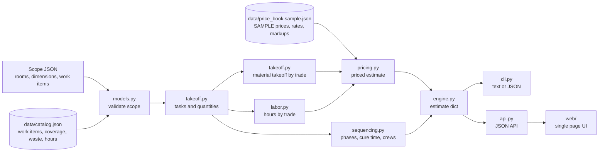

# remodel-estimator

Turn a measured remodel scope into an estimate a crew can build from: what to buy by trade (with waste, rounded up to whole boxes, bags and sheets), labor hours by trade, the order of work, and a price.

It is for remodeling contractors and for people building estimating tools for them. Estimating by hand means redoing the same takeoff, waste, labor and markup arithmetic on every job, and small slips compound into a wrong price. Here you describe the job once (rooms, dimensions, work items) and the same rules run every time, from a catalog and a price book you control.

> **Every price in this repository is fake and labelled sample.** The bundled price book (`data/price_book.sample.json`) is invented for demonstration and is meant to be replaced. Put in your own prices, rates and markups before quoting any real work.

## What you will see

`python -m remodel_estimator estimate bathroom` estimates a gut remodel of a 5 x 8 ft hall bath. This is an excerpt of the real output (the full report is about 215 lines; `...` marks cuts):

```
ESTIMATE: Sample hall bathroom remodel
Price book: Sample price book (SAMPLE PRICES, NOT REAL)

ROOMS
  Hall bath        8 x 5 x 8 ft   floor 40 sf   walls 176 sf   perimeter 26 lf   baseboard 10 lf
...
MATERIAL TAKEOFF BY TRADE (waste included, rounded up to whole purchase units)
  [drywall]
    material                                                 net  waste   buy unit         each    extended
    Drywall screws 1-1/4 in, 5 lb box (sample)              0.18   0.0%     1 box        $29.00      $29.00
    Drywall sheet 4x8, half inch (sample)                   4.69  12.0%     6 sheet      $15.50      $93.00
    Drywall paper tape, 250 ft roll (sample)                0.25   0.0%     1 roll        $6.00       $6.00
    All purpose joint compound, 4.5 gal (sample)            0.33   0.0%     1 bucket     $21.00      $21.00
  [tile]
    material                                                 net  waste   buy unit         each    extended
    Alkali resistant mesh tape, 150 ft roll (sample)        0.46   0.0%     1 roll        $9.00       $9.00
    Backer board screws 1-1/4 in, box of 185 (sample)       1.63   0.0%     2 box        $13.50      $27.00
    Cement backer board 1/2 in, 3x5 (sample)                5.00  10.0%     6 sheet      $17.00     $102.00
    Cement backer board 1/4 in, 3x5 floor (sample)          2.67  10.0%     3 sheet      $14.00      $42.00
    Grout, 25 lb bag (sample)                               1.15   5.0%     2 bag        $24.00      $48.00
    Thinset mortar, 50 lb bag (sample)                      2.83   5.0%     3 bag        $29.00      $87.00
    Floor tile, per square foot (sample)                   40.00  10.0%    44 sf          $6.40     $281.60
    Wall tile, per square foot (sample)                    75.00  12.0%    84 sf          $5.25     $441.00
    Liquid waterproofing membrane, gallon (sample)          1.50   5.0%     2 gal        $64.00     $128.00
...
LABOR BY TRADE
  trade           hours  billable      rate         cost
  plumbing        21.50     21.50   $110.00    $2,365.00
  electrical       8.70      8.70   $105.00      $913.50
  drywall          9.60      9.60    $65.00      $624.00
  tile            35.60     35.60    $80.00    $2,848.00
...
SEQUENCE (17 working days, one crew per trade; start and end are working days elapsed since the job started)
   start    end  room         work item                              trade       note
       4   4.16  Hall bath    Hang ceiling drywall                   drywall
       4      5  Hall bath    Cement backer board                    tile
    4.16    4.5  Hall bath    Hang wall drywall                      drywall
       5   5.16  Hall bath    Ceiling drywall: tape coat             drywall     then wait 1 day to dry
       5    5.5  Hall bath    Roll on waterproofing membrane         tile        then wait 1 day to cure
    5.16    5.5  Hall bath    Wall drywall: tape coat                drywall     then wait 1 day to dry
     6.5   6.63  Hall bath    Ceiling drywall: second coat           drywall     then wait 1 day to dry
     6.5      9  Hall bath    Tile shower walls                      tile        then wait 1 day to cure
    6.63      7  Hall bath    Wall drywall: second coat              drywall     then wait 1 day to dry
       8   8.13  Hall bath    Ceiling drywall: finish coat           drywall     then wait 1 day to dry
    8.13    8.5  Hall bath    Wall drywall: finish coat              drywall     then wait 1 day to dry
     9.5   9.64  Hall bath    Ceiling drywall: sand                  drywall
    9.64     10  Hall bath    Wall drywall: sand                     drywall
      10  10.26  Hall bath    Paint ceiling                          paint
   10.26     11  Hall bath    Prime and paint walls                  paint
      11   11.5  Hall bath    Floor tile underlayment, backer board  tile
    11.5   12.5  Hall bath    Tile floor                             tile        then wait 1 day to cure
...
    14.5  14.87  Hall bath    Outlet or switch: device and plate     electrical
   14.87     15  Hall bath    Bath fan: grille and test              electrical
...
TOTALS
  Materials                       $4,422.60
  Sales tax on materials            $353.81
  Labor                           $8,527.05
  Direct cost                    $13,303.46
  Overhead                        $1,330.35
  Contingency                       $665.17
  Profit                          $1,529.90
  -----------------------------------------
  ESTIMATE TOTAL                 $16,828.88

NOTES
  * insulation: 0.98 estimated hours raised to the 2 hour trade minimum.
  * general: 1.4 estimated hours raised to the 2 hour trade minimum.
  * Prices come from a sample price book and are not real. Replace it before quoting.

ASSUMPTIONS (catalog defaults used in this estimate; check them against how you build)
...
  * Backer board screws: coverage assumes a box of 185 screws, 1-1/4 inch. Walls take about 2
    screws per sf (8 inches on center into studs at 16 inches), so one box covers about 90 sf.
    Floors take about 3.7 per sf (8 inches on center both ways), so one box covers about 50 sf.
    Seams are mesh taped and filled from the tile thinset.
  * Floor tile underlayment default: 1/4 inch cement backer board bedded in thinset over a sound
    wood subfloor, screwed 8 inches on center, seams mesh taped and filled with thinset. It goes
    down after paint, right before the floor tile. If you use an uncoupling membrane instead,
    swap this item for your own.
  * Hall bath: baseboard is 10 lf: the 26 lf perimeter less 3 lf for 1 door opening at 3 lf
    each, 10 lf for shower alcove, 3 lf for vanity.
```

The dollar figures mean nothing: they come from the sample price book. What carries over to a real job is the method, for example 75 sf of shower wall becoming 84 sf of tile, 6 sheets of backer board and 2 gallons of membrane, the floor getting its own backer board before tile, and the shower being tiled while the drywall coats dry. The full output for all three examples is in [`demo/output.txt`](demo/output.txt).

## What it does

Given a scope JSON file, the engine produces:

- **Material takeoff by trade.** Each work item lists the materials it needs, how much one purchase unit covers, and a waste factor. Quantities are summed per SKU across all rooms and rounded up once to whole purchase units.
- **Labor hours by trade.** Setup hours plus hours per unit for every visit, scaled by a per room difficulty factor, with each trade's minimum billable hours applied.
- **Sequencing.** Work is ordered by phase inside each room (demolition, rough-in, shower base, board hanging, drywall coats, waterproofing, wall tile, paint, floor underlayment, floor tile, cabinets, finish plumbing, finish electrical, trim, trim paint), with cure and dry time, and one crew per trade so a trade is never in two places at once. One scope line can be several visits: drywall is hang, tape coat, second coat, finish coat and sand; an outlet is a rough-in visit and a trim-out visit.
- **A priced estimate.** Materials, sales tax on materials, labor, overhead, contingency and profit, plus direct cost by trade. Money is computed with `Decimal` and rounded half up.
- **Notes.** Missing prerequisites (for example wall tile with no backer board, or floor tile with no underlayment or slab prep in scope), trade minimums that were applied, and a reminder whenever the sample price book is in use.
- **Assumptions.** The catalog defaults that shaped this estimate (underlayment type, drywall coat schedule, fastener box sizes, how the baseboard length was worked out), printed so they can be checked.

It ships as a Python engine with tests, a command line tool, and a single page web UI (static HTML and JS calling a small JSON API), with bathroom, kitchen and basement examples. The engine, CLI and API use the Python standard library only.

## Run it

Needs Python 3.10 or newer. Nothing to install for the app itself.

```
python -m remodel_estimator estimate bathroom
python -m remodel_estimator serve
```

The first command prints the full estimate for the bathroom example. The second starts the API and web UI at http://127.0.0.1:8000 (use `--port` if 8000 is taken). The web UI needs that server running: the page calls the API for the catalog and for every estimate.

Other commands:

```
python -m remodel_estimator estimate examples/kitchen.json --json
python -m remodel_estimator estimate basement --price-book path/to/your_price_book.json
python -m remodel_estimator examples
python -m remodel_estimator catalog
```

## Run the tests

pytest is the only dependency, and only for the tests. A virtual environment in the project folder keeps it out of your system Python:

```
python -m venv .venv
.venv\Scripts\activate
python -m pip install -r requirements-dev.txt
python -m pytest
```

On macOS or Linux the second line is `source .venv/bin/activate`.

There are 105 tests covering room geometry, scope validation, takeoff and waste math, labor minimums, sequencing rules, the trade logic (floor substrate, rough and finish visits, drywall coats, baseboard deductions, fastener coverage, pinned production rates), pricing arithmetic checked against a hand calculation, the CLI, and the API over a real local socket. CI (`.github/workflows/ci.yml`) runs the tests and the demo on Python 3.10 and 3.12.

## Demo

```
python demo/run_demo.py
```

Runs fully offline. It estimates the bathroom, kitchen and basement examples, then starts the API on a free local port and posts a scope to it. It rewrites [`demo/output.txt`](demo/output.txt), which ends like this:

```
SUMMARY (sample prices)
  Sample hall bathroom remodel      17 working days   $   16,828.88
  Sample kitchen remodel            18 working days   $   23,825.87
  Sample basement finish            25 working days   $   34,735.92

API ROUND TRIP (local server on a free port, same engine as the CLI)
  POST /api/estimate -> HTTP 200
  project        Sample hall bathroom remodel
  price book     Sample price book (sample: True)
  takeoff lines  37
  working days   17
  total          $16,828.88 (sample prices)
```

## Scope format

```json
{
  "project": "Sample hall bathroom remodel",
  "rooms": [
    {
      "name": "Hall bath",
      "length_ft": 8, "width_ft": 5, "height_ft": 8,
      "doors": 1, "windows": 1,
      "labor_factor": 1.0,
      "base_deductions": [
        {"label": "shower alcove", "lf": 10},
        {"label": "vanity", "lf": 3}
      ],
      "work_items": [
        {"code": "floor_backer_board"},
        {"code": "tile_floor"},
        {"code": "cement_board", "qty": 75},
        {"code": "tile_shower_walls", "qty": 75, "waste": 0.15},
        {"code": "baseboard"}
      ]
    }
  ]
}
```

- Items measured from the room (`floor_sf`, `wall_sf`, `ceiling_sf`, `perimeter_lf`, `baseboard_lf`) need no quantity. Give `qty` to override.
- Items measured in `lf` or `sf` that the room cannot tell you (cabinet runs, shower wall area) need a `qty`. Items counted `each` default to 1.
- `waste` overrides the catalog waste factor for one item, for example a diagonal tile layout.
- `labor_factor` scales labor in one room, for example 1.1 for a basement with tight access.
- Wall area is the gross perimeter times height, less 20 sf per door and 12 sf per window.
- Baseboard length is the perimeter less 3 lf per door, less every run listed in `base_deductions` (tub or shower, vanity, cabinets, appliances). `base_deductions` is optional: a scope without it still works and deducts the doors only. The estimate prints the arithmetic for each room.
- A staged item is still one line in the scope. `{"code": "drywall_walls"}` produces the five drywall visits and `{"code": "device", "qty": 3}` produces the rough-in and the trim-out.

Run `python -m remodel_estimator catalog` for the list of work item codes.

## Replace the price book

1. Copy `data/price_book.sample.json` to a new file and set `"sample": false`.
2. Put in your own material unit prices, labor rates, trade minimum hours, crew sizes and markups.
3. Point the app at it with `--price-book your_file.json` or the `REMODEL_PRICE_BOOK` environment variable (see `.env.example`).

If your price book is missing a SKU or a trade that the scope needs, the estimate fails with a list of what is missing. It never silently prices something at zero. Coverage, waste factors and labor hours per unit live in `data/catalog.json`; tune those to your own crews and products too.

**The production rates are sample values.** The hours per unit in the catalog were sanity checked against the ranges in commonly published residential repair and remodeling labor guides (annual cost data books, trade association labor unit manuals, manufacturer installation guides) and set toward the small room end of those ranges. They are not measured from any crew. A contractor should replace them with numbers from their own jobs before trusting the labor hours or the schedule.

## Assumptions a contractor should check

These are the defaults built into the catalog and the examples. Each one is a judgment call that another contractor could reasonably make differently. The ones that apply are printed under ASSUMPTIONS on every estimate.

- **Floor tile underlayment.** 1/4 inch cement backer board bedded in thinset over a wood subfloor, screwed 8 inches on center, seams mesh taped. It goes down after paint, right before the floor tile. An uncoupling membrane is not in the catalog. Tile on a slab uses `slab_floor_prep` (scrape and patch) with no board. Tile floor with neither in scope gets a note.
- **Shower walls.** 1/2 inch cement board, mesh taped seams, then two coats of roll on membrane (about 50 sf per gallon finished) and one cure day before tile.
- **Backer board screws.** A box of 185 screws, 1-1/4 inch. About 2 per sf on walls (90 sf per box) and 3.7 per sf on floors (50 sf per box).
- **Drywall.** Ceilings before walls. Hang, tape coat, second coat, finish coat, sand, with one dry day after each coat (all purpose premixed compound). One 4.5 gallon bucket of compound per 450 sf across the three coats, a 250 ft roll of tape per 600 sf, a 5 lb box of screws per 900 sf of wall or 750 sf of ceiling. Setting compound would shorten the dry days.
- **Shower and drywall overlap.** Waterproofing and wall tile wait for the boards to be hung, not for the drywall to be finished, so the tile setter works while the coats dry. Paint waits for both the sanding and the tile cure.
- **Electrical.** Two visits. Rough-in (boxes, cable, fan housing and duct) before insulation and drywall. Trim-out (devices, plates, light fixtures, fan grille) after paint, wall tile and backsplash. Per device: 0.6 hours rough, 0.3 hours finish, plus half an hour of setup on the trim-out visit.
- **Shower valve.** Valve body at rough-in (2 hours), trim and shower head after tile (0.75 hours).
- **Baseboard.** Perimeter less 3 lf per door opening, less the runs you list in `base_deductions`. The bathroom example deducts a 10 lf shower alcove (5 ft back wall and two 2.5 ft returns) and a 3 ft vanity, leaving 10 lf.
- **Trim paint.** Baseboard and doors arrive primed and go in after wall paint, so they get their own paint visit (fill, caulk, two coats).
- **Floating plank floor.** Luxury vinyl plank goes in after base cabinets and runs to the toe kick, never under the cabinets. The kitchen example takes the 28 sf cabinet footprint out of the floor quantity.
- **Walls on a slab.** Pressure treated bottom plate over sill sealer, concrete fasteners about every 32 inches, double top plate.
- **Visits.** Everything one trade does in one room in one phase is one visit, rounded up to half days.
- **Key production rates (sample).** Rough plumbing 4 hours per fixture plus 1 hour setup. Remove a fixture 1.25 hours. Shower wall tile 0.22 hours per sf, floor tile 0.16, floor backer board 0.08, wall backer board 0.05. Wall drywall 0.045 hours per sf across all five visits, ceilings 0.06. Prime and two coats on walls 0.025 hours per sf. Baseboard 0.05 hours per lf to install and 0.04 to paint. With these the bathroom example comes to about 104 labor hours.

## Architecture



## API

| Method | Path | Returns |
| --- | --- | --- |
| GET | `/api/health` | status and the price book header, including the sample flag |
| GET | `/api/catalog` | selectable work items and phases |
| GET | `/api/examples` | list of example scopes |
| GET | `/api/examples/<name>` | one example scope |
| POST | `/api/estimate` | scope JSON in, estimate JSON out. A bad scope returns 400 with every problem listed |

## Where this pattern runs

This is drawn from systems that run two small service companies day to day, where estimates are built from a measured scope, a catalog of work items and a price book rather than retyped per job. The code here is a clean, standalone version of that pattern with invented data.

## Limitations

- **The numbers are not real.** Prices, labor rates, production rates, coverage and waste factors are all sample values chosen to look plausible. Do not quote from them.
- **Rooms are rectangles.** No L shapes, sloped ceilings, soffits or stairs. Use `qty` overrides for anything irregular. Baseboard deductions are only as good as the runs you list: nothing is deducted for a tub, vanity or cabinet run unless it is in `base_deductions`.
- **Flat production rates.** Labor is setup plus hours per unit with one multiplier per room. There is no learning curve, no small job premium beyond the trade minimum, and no travel time.
- **Simple sequencing.** Phases within a room, cure and dry time, and one crew per trade. It does not model inspections, lead times (a fabricated countertop is templated and installed in one visit), deliveries, weekends, or one trade waiting on another trade's work in a different room. Paint is one visit with no recoat time between coats. Dry and cure waits are whole days at normal room conditions. Start and end times inside a shared visit are proportional to hours, so read them as an order, not a clock. The day count is working days, not a calendar.
- **One price per SKU.** No quantity breaks, supplier choice, allowances versus selections, or regional adjustment. Tax applies to materials only and markups are single percentages.
- **Catalog is small.** 41 work items aimed at bathrooms, kitchens and basements. No structural work, HVAC, roofing, exterior work or permits. One floor tile underlayment (cement backer board) and one shower system (cement board with roll on membrane). No uncoupling membrane, sheet membrane, mud bed or self leveling. No below slab plumbing for a basement bath. No panel or service work behind a new circuit.
- **The API is a development server.** It uses the standard library HTTP server with no authentication, no rate limiting and no TLS. Run it on localhost or put it behind something that handles those.
- **No persistence.** Estimates are computed and returned, not saved. There are no revisions, change orders or customer records.

License: MIT, see the LICENSE file.
